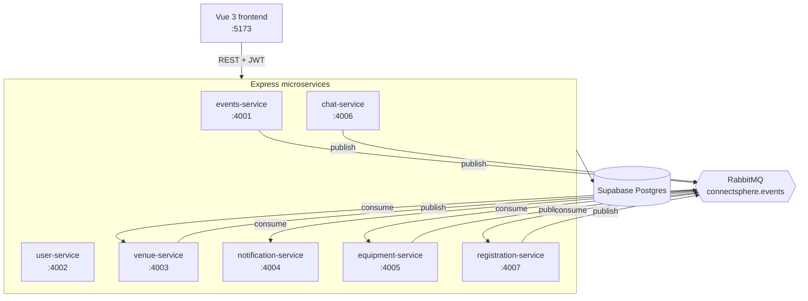
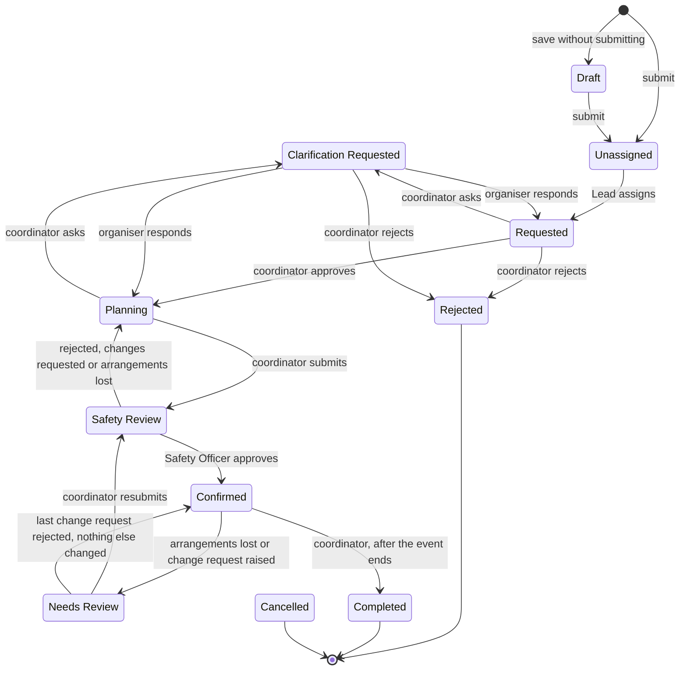

# ConnectSphere

[](https://github.com/triciaaleee/SPM-G6T5/actions/workflows/ci.yml)

**ConnectSphere plans client events from first request to completion.** Organisers submit requests, coordinators arrange venues and equipment, a safety officer signs off, and attendees discover and register for confirmed events.

Built by team G6T5 with Vue 3, TypeScript, Express microservices, Supabase Postgres and RabbitMQ.

## Contents

- [Who uses it](#who-uses-it)
- [Features](#features)
- [Architecture](#architecture)
- [Event lifecycle](#event-lifecycle)
- [Getting started](#getting-started)
- [Run with Docker](#run-with-docker)
- [Test accounts](#test-accounts)
- [Frontend](#frontend)
- [Testing](#testing)
- [CI](#ci)
- [Contributing](#contributing)
- [Project layout](#project-layout)
- [Documentation](#documentation)

## Who uses it

| Role | What they do |
|---|---|
| **Event Organiser** | Submits and edits event requests, answers clarifications, raises change requests, and cancels their own events |
| **Event Coordinator Lead** | Watches the unassigned queue, assigns and reassigns coordinators, and oversees workload |
| **Event Coordinator** | Reviews assigned requests, arranges venues and equipment, submits events for safety review, and decides change requests |
| **Safety Officer** | Runs the Operational Safety Check: approves, rejects or requests changes |
| **Venue Staff** | Maintains venues and block-out periods, and holds, approves or rejects booking requests |
| **Technical Support** | Maintains the equipment inventory and reserves items for events |
| **Attendee** | Discovers events, registers and withdraws |

## Features

| Area | What it covers |
|---|---|
| **Event requests** | Drafts, submitting and editing requests, clarification questions, an unassigned queue for the Lead, assigning and reassigning coordinators, and coordinator workload views |
| **Planning and safety** | Approving or rejecting requests, submitting events for the Operational Safety Check, safety outcomes with reasons, change requests that hold critical fields for review, completing events, and organiser cancellation |
| **Venues** | Search and recommendations, suitability checks per booking, several venues per event, booking requests, 72-hour holds, automatic rejection of overlapping requests, setup and turnaround times, block-out periods, schedules and finding replacements |
| **Equipment** | Requests per event, reserving individual units, partial fulfilment, inventory by date, and marking units out of use |
| **Registration** | Event discovery, registering and withdrawing, capacity limits, coordinator-set opening dates and manual open or close, and event rosters |
| **Communication** | An in-app notification feed, and a chat thread between an event's organiser and its assigned coordinator |
| **Public pages** | Guests can browse a welcome page, events and venues without logging in |

## Architecture

Each entity has its own service, and each service reads and writes only its own tables. Services reach each other's data through REST APIs and announce changes through RabbitMQ.



| Service | Port | Responsible for |
|---|---|---|
| **events-service** | 4001 | Event requests, the lifecycle, assignment, safety review, change requests and the registration period |
| **user-service** | 4002 | Sign-up, login, JWT issuing and user records |
| **venue-service** | 4003 | Venues, search and recommendations, bookings, holds and block-out periods |
| **notification-service** | 4004 | Each user's notification feed, filled only by RabbitMQ messages |
| **equipment-service** | 4005 | Equipment requests, inventory, units and reservations |
| **chat-service** | 4006 | Message threads between an event's organiser and coordinator |
| **registration-service** | 4007 | Attendee registration, withdrawal and event rosters |

**How the services work together**

- **Login:** user-service issues JWTs, and every other service only verifies them with the shared `JWT_SECRET`.
- **Service-to-service calls:** calls with no user token to forward use short-lived tokens signed with `INTERNAL_SERVICE_SECRET`. For example, notification-service looks up who holds a role in user-service, and venue-service's hold sweep reads `GET /api/events/venue-booking-info`.
- **Hold warnings:** venue-service checks holds every 15 minutes and warns the coordinator 12 hours before one expires, recording this in `venue_bookings.expiry_warning_sent_at` so each hold is only warned about once.
- **Chat limits:** `GET /api/chat/:eventId/messages?limit=50&before=<id>` returns a page of history with `hasMore` and `nextBefore`. Each user can send 30 messages a minute by default, set with `CHAT_SEND_LIMIT_PER_MINUTE`, after which the API returns `429` with `Retry-After`.
- **Messaging:** most messages are best effort, while critical ones such as `event.cancelled` are stored in an outbox and retried until RabbitMQ confirms them. [RabbitMQ.md](RabbitMQ.md) lists every message, who publishes it and who consumes it.

## Event lifecycle

The status machine is fixed and enforced by the backend. An illegal transition returns `409` or `400`.



The Organiser can also move an event to **Cancelled** from any active status, which releases its venues and equipment and notifies everyone affected. The full rules are in [AGENTS.md](AGENTS.md).

## Getting started

### Prerequisites

- Node.js 22
- Docker, for RabbitMQ
- A Supabase project

### 1. Install

```bash
cd backend
npm install
for service in services/*/; do npm install --prefix "$service"; done

cd ../frontend
npm install
```

### 2. Configure

```bash
cp backend/.env.example backend/.env
cp frontend/.env.example frontend/.env
```

Then fill these in `backend/.env`. Every service shares this one file, so don't add per-service `.env` files.

| Variable | What it is |
|---|---|
| `SUPABASE_URL` | Your Supabase project URL |
| `SUPABASE_SERVICE_ROLE_KEY` | Your project's service-role key |
| `JWT_SECRET` | A long random string for signing logins |
| `INTERNAL_SERVICE_SECRET` | A different long random string for service-to-service calls |

The ports, service URLs and `RABBITMQ_URL` already have working local values in the example file, along with the optional chat settings.

### 3. Set up the database

**Using a hosted Supabase project:** apply the files in `supabase/migrations/` in order, then run `supabase/seed.sql` for test data.

**Using a throwaway local database,** which keeps your testing out of any shared data (needs the [Supabase CLI](https://supabase.com/docs/guides/local-development), `psql` and Docker):

```bash
supabase start
supabase/scripts/build_database.sh "$(supabase status -o env | sed -n 's/^DB_URL="\(.*\)"$/\1/p')"
```

Then set `SUPABASE_URL` and `SUPABASE_SERVICE_ROLE_KEY` in `backend/.env` to the `API_URL` and `SERVICE_ROLE_KEY` values from `supabase status`. Run `build_database.sh` only against an empty local database, and use `supabase stop --no-backup` to throw it away.

### 4. Start RabbitMQ

From the repo root:

```bash
docker compose up -d rabbitmq
docker logs connectsphere-rabbitmq | grep "Server startup complete"
```

**Wait for that line to appear before starting the backend**, because a service that can't reach RabbitMQ at startup doesn't retry. The management UI is at <http://localhost:15672> (guest / guest).

### 5. Start the app

In one terminal, start every backend service:

```bash
cd backend
npm run dev
```

In another, start the frontend:

```bash
cd frontend
npm run dev
```

Open <http://localhost:5173>.

### 6. Check it's running

```bash
for port in 4001 4002 4003 4004 4005 4006 4007; do curl -s "http://localhost:$port/health"; echo; done
```

Each line should say `{"ok":true}`. To check them all without starting them first, stop any running services and use `cd backend && npm run smoke`.

## Run with Docker

Once `backend/.env` is filled in, you can run the whole stack, including the frontend, with one command from the repo root:

```bash
docker compose up --build -d     # build and start everything
docker compose ps                # every backend service should show (healthy)
docker compose logs -f events-service
docker compose down              # stop (add -v to also wipe RabbitMQ's data)
```

- The app is at <http://localhost:5173>, and the services use the same ports as `npm run dev`, so **stop any local `npm run dev` first**.
- Leave the URLs in `backend/.env` as `localhost`. Compose overrides them so the containers reach each other by name.
- Images run the compiled build, so rebuild after changing code: `docker compose up --build -d <service>`.
- The frontend's API URLs are set at build time. To change them, pass build args, such as `docker compose build --build-arg VITE_EVENTS_API_URL=... frontend`.

## Test accounts

`supabase/seed.sql` creates these accounts. The password for all of them is `password123`.

| Role | Email |
|---|---|
| Event Organiser | `organiser-one@example.com`, `organiser-two@example.com` |
| Event Coordinator Lead | `coordinator-lead@example.com` |
| Event Coordinator | `coordinator-one@example.com`, `coordinator-two@example.com` |
| Safety Officer | `safety-officer-one@example.com` |
| Venue Staff | `venue-staff-one@example.com` |
| Technical Support | `tech-support-one@example.com` |
| Attendee | `attendee-one@example.com`, `attendee-two@example.com`, `attendee-three@example.com` |

**Creating more accounts:** attendees and organisers can sign up at `/signup`, with a password of 8 to 72 characters including a letter and a number. Staff roles have no sign-up, so insert them into `users` directly, then run `select sync_user_id_sequences();` so new sign-ups don't reuse their IDs.

## Frontend

The frontend is a Vue 3 and TypeScript app built with Vite, using Vue Router and Tailwind CSS. All UI work must follow [Style.md](Style.md), the design system.

| Folder (in `frontend/src/`) | What's in it |
|---|---|
| `views/` | One folder of pages per area, such as `attendee/`, `coordinator/`, `lead/`, `safety/` and `venue-staff/` |
| `components/` | Shared components, including the `ui/` building blocks |
| `lib/` | API clients and shared logic |
| `router/` | Routes and the role guard |

Run these from `frontend/`:

```bash
npm run dev       # start the dev server at http://localhost:5173
npm test          # unit tests with Vitest
npm run lint      # ESLint
npm run build     # type-check and build for production
npm run e2e       # Playwright tests (needs the backend running)
```

The API URLs come from `frontend/.env`. The defaults in `.env.example` work for local development.

## Testing

| Layer | Command | Runs in CI? | What it checks |
|---|---|---|---|
| **Unit** | `npm test` | Yes | Each service and the frontend, with other services mocked |
| **Coverage** | `npm run test:coverage` | No | Unit tests with a v8 coverage report |
| **Integration** | `npm run test:integration` | No | A service against a real Supabase database |
| **Mutation** | `npm run test:mutation` | No | Whether the unit tests notice deliberately broken code, using Stryker |
| **End-to-end** | `npm run e2e` (in `frontend/`) | Yes | Full user flows with Playwright against the real services |

Run the first four from any service's folder, for example:

```bash
cd backend/services/registration-service
npm test
npm run test:coverage
npm run test:integration
npm run test:mutation
```

> [!WARNING]
> `npm run test:integration` writes to the Supabase project in `backend/.env`. The tests use throwaway rows and delete them afterwards, but check which database you're pointing at first. `npm run e2e` also writes to it unless you use a local Supabase, as described in [frontend/e2e/README.md](frontend/e2e/README.md).

Every service has the same four commands. A full mutation run can take from a few minutes to about 20 minutes, depending on the service, so use `npm run test:mutation -- --mutate 'src/lib/**/*.ts'` for a quicker run. Reports are written to `coverage/` and `reports/mutation/`. A mutant that can't change behaviour is marked `// Stryker disable next-line <Mutator>: <why>` in the source.

**Keeping tests deterministic:** events-service reads the time only through `lib/clock.ts`, and runs its tests with no sockets and no retries. To try a different time zone or order there:

```bash
TEST_TZ=Asia/Singapore npx vitest run --sequence.shuffle --sequence.seed=1
```

## CI

Every pull request and push to `main` runs [`ci.yml`](.github/workflows/ci.yml): secret scan, lint, type-check, unit tests for every service, a frontend build, a smoke test that boots every service, and Playwright end-to-end tests. See [CI.md](CI.md) for details.

To run the main checks before pushing:

```bash
cd backend && npm run lint && npm run smoke
cd frontend && npm run lint && npm test && npm run build
cd backend/services/<service> && npx tsc -p tsconfig.json --noEmit && npm test
```

## Contributing

1. Branch from `main`, using a short descriptive name such as `RegistrationServiceTesting`.
2. Read [AGENTS.md](AGENTS.md) first. Its rules are mandatory, including the fixed event lifecycle and one service owning each table.
3. Add or update tests, and run the [checks above](#ci) before pushing.
4. Open a pull request into `main`, and get a teammate's review with CI passing.

- **Database changes** go in a new numbered file in `supabase/migrations/`, named `NNNN_description.sql`.
- **A new entity** gets a new service. The checklist is in [AGENTS.md](AGENTS.md), and CI picks up the new folder automatically.
- **New env vars, ports or scripts** must also be added to `backend/.env.example` and the docs in the same change.

## Project layout

```text
backend/
  .env.example          One config file shared by every service
  scripts/smoke.mjs     Boots every service and checks /health
  services/             One folder per microservice
c4_diagrams/            C4 model and Architecture Decision Record
frontend/
  src/                  Vue 3 app
  e2e/                  Playwright tests
supabase/
  migrations/           Numbered SQL migrations
  seed.sql              Test data
docker-compose.yml      Runs RabbitMQ, or the whole stack
```

## Documentation

| Document | What's in it |
|---|---|
| [AGENTS.md](AGENTS.md) | Project rules: microservices, the event lifecycle, venue bookings, registration and conventions |
| [Style.md](Style.md) | The frontend design system |
| [RabbitMQ.md](RabbitMQ.md) | Exchanges, queues, every message, reliable delivery and known limitations |
| [CI.md](CI.md) | Every CI job, how to run the checks locally, and the decisions behind them |
| [c4_diagrams/](c4_diagrams) | C4 diagrams as Structurizr DSL (`.dsl`) files, and the [Architecture Decision Record](c4_diagrams/ArchitectureDecisionRecord.md) |
| [frontend/docs/frontend-audit.md](frontend/docs/frontend-audit.md) | A design-consistency audit of the frontend against Style.md |
| [frontend/e2e/README.md](frontend/e2e/README.md) | Running the Playwright tests, including against a local database |
